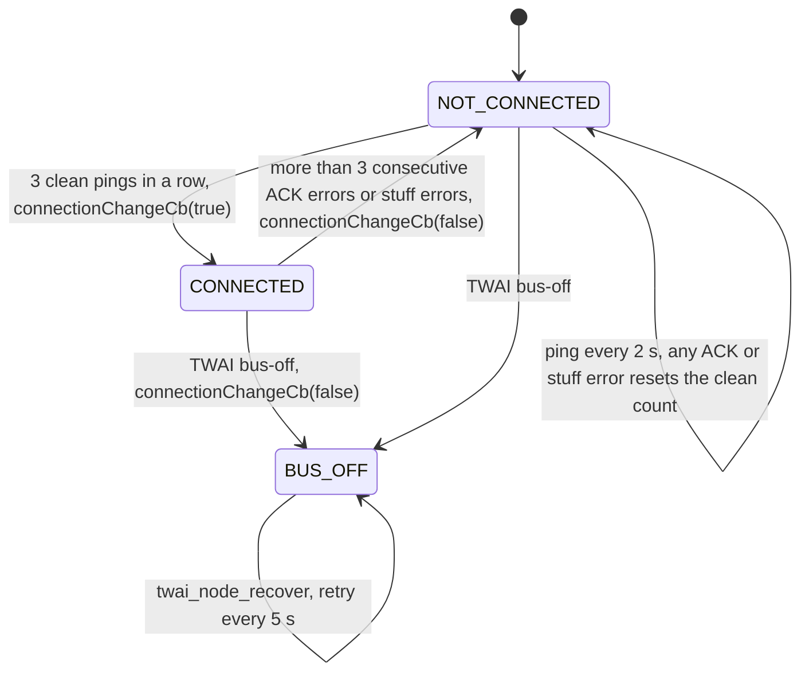
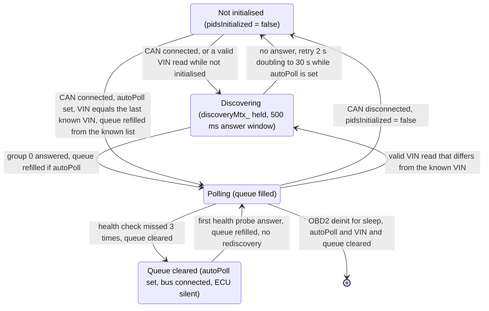
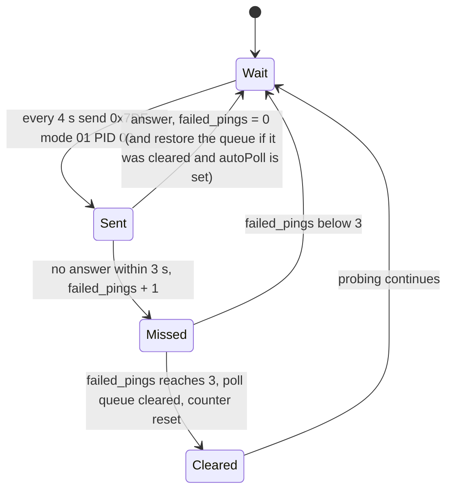
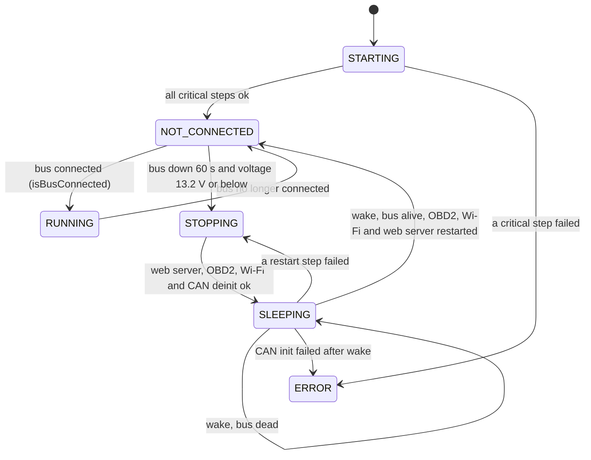

# Architecture

Facts below were read from the code at app version 0.5.0 (`sw/firmware/main/include/utilities.h`). ESP-IDF 6.1 (GCC 15.2, Picolibc, default `-std=gnu++26`), ESP32-S3.

## Components
All paths are relative to `sw/firmware/`. Dependencies are the `REQUIRES` / `PRIV_REQUIRES` in each `CMakeLists.txt`, plus the includes the code really uses.

| Component | Path | Responsibility | Depends on |
|---|---|---|---|
| main (app) | `main/` | `app_main`, then the pieces below that have no component of their own: Supervisor (`src/supervisor.cpp`), Settings (NVS, `src/settings.cpp`), Battery ADC (`src/battery.cpp`), LED (`include/led_status.hpp`), Web server routes and WebSocket (`src/webserver.cpp`), Middleware (`src/middleware.cpp`) | driver, can_driver, obd2, obd2_simulator, wifi, async_web_server, esp_http_server, esp_adc, sd_card; private: json (`espressif/cjson`); managed: `joltwallet/littlefs` |
| Supervisor | `main/src/supervisor.cpp` | Runs the init steps in order, owns the state machine, sleep and wake (`power.md`), loads and saves the PID JSON on the SD card, file copy | Settings, SD card, CAN driver, OBD2, WiFi, web server, Battery, LED, middleware (`m_pid_def_put`) |
| CAN driver | `components/can_driver/` | TWAI node, RX and TX queues, TX task, bus health check task, connected/disconnected callback, loopback/debug mode, `isBusConnected()`, `quickCheckBus()`. Operation admission: `transmit`, `transmitUrgent`, `receive`, `availableMessages`, `flushRxQueue`, `getStatus` and `quickCheckBus` go through `OpGate` (`include/op_gate.hpp`); `deinit()` closes it, waits up to 3 s for calls in flight and returns `ESP_ERR_TIMEOUT` (nothing freed) if one is still blocked, `transmit` and `receive` clamp their timeout to 2 s so the drain always outlasts them. The TX-done hook ({fn,arg}) is one `HookCell` (`include/hook_cell.hpp`): the ISR reads a consistent pair without blocking, and `setTxDoneHook` returns true only after any callback running on the old pair has finished (false after 200 ms), so the caller may free the old arg (OBD2 init fails and OBD2 deinit returns `ESP_ERR_TIMEOUT` when it returns false) | esp_driver_twai, driver |
| OBD2 | `components/obd2/` | The `OBD2` class is split by concern: `obd2.cpp` (lifecycle, callbacks), `obd2_poll.cpp`, `obd2_rx.cpp`, `obd2_transport.cpp`, `obd2_discovery.cpp`, `obd2_recovery.cpp`, `obd2_diag.cpp`, with private shared bits in `obd2_internal.hpp`. Contents: PID database (`obd2_data_model.cpp`), formulas (`pid_def.cpp`), hardware-free frame parsing and ISO-TP reassembly (`obd2_frame.cpp`), PID JSON validation and serialization (`pid_json.cpp`), poll scheduler (`include/pid_priority_queue.hpp`), receive task, ISO-TP multi-frame (DTC, VIN), supported-PID discovery, DTC and VIN requests | can_driver, tinyexpr. It does not touch the SD card; the supervisor does the JSON file I/O |
| TinyExpr | `components/tinyexpr/` | Vendored expression parser (compiled with `-w`) | – |
| OBD2 simulator | `components/obd2_simulator/` | Answers requests with synthetic frames when the CAN config has `debug=true`. Two ECUs: 0x7E8 answers everything (PIDs, DTC, VIN), 0x7E9 only DTC and VIN requests (own DTC set overlapping ECU 0, same VIN); flow control sent to 0x7E0 or 0x7E1 releases that ECU's consecutive frames. The RX ISR passes CAN ID and data bytes to a 16-entry static queue (`simDroppedFrames` counts overflows) | can_driver, obd2 |
| SD card | `components/sd_card/` | SDMMC mount, hot-plug via the card-detect pin, task-affine operation lease (recursive mutex), file ops, path validation | driver, fatfs, freertos, sdmmc; private: json |
| WiFi | `components/wifi/` | AP, STA or AP+STA, STA retry then AP fallback, mDNS | esp_wifi, nvs_flash, espressif/mdns |
| Async web server | `components/async_web_server/` | Wraps `esp_http_server`: request queue, worker tasks, rate limit, WebSocket broadcast | esp_http_server, esp_timer |
| Web server (routes) | `main/src/webserver.cpp`, `main/src/middleware.cpp` | REST routes, WebSocket handler. `webserver.cpp` does HTTP parsing and calls `m_*` functions in `middleware.cpp`, which return cJSON | OBD2, SD card, Settings, Supervisor, CAN driver |
| Frontend | `../frontend/` (Svelte, built with bun) | UI, served as one gzipped file from the `www` LittleFS partition | REST and WebSocket only |
| Recorder (planned) | – | Trip detection, CSV logging, 0–100 timing. Not in the code | OBD2, SD |
| OTA (planned) | – | Not in the code (`ota.md`). `partitions.csv` already has `otadata`, `ota_0`, `ota_1` | – |
| Modem (v2, planned) | – | Not in the code | – |

Layering discrepancies, as built:
- `webserver.cpp` calls `SDCard` directly for SD file upload and download, instead of going through `middleware.cpp`. The rule in `CLAUDE.md` says firmware data goes through the middleware.
- `supervisor.cpp` includes `middleware.hpp` (it calls `m_pid_def_put` to load PID JSON), so the supervisor depends on the web layer.
- `main/main.cpp.disabled_sd` is a stray, unused file.

### Frontend packaging (as built)
`main/CMakeLists.txt` defines a custom target that runs `bun run build` in `sw/frontend`, then `littlefs_create_partition_image(www "../../frontend/dist" FLASH_IN_PROJECT)` builds a LittleFS image from `sw/frontend/dist` and flashes it to the `www` partition (1M in `partitions_v1.csv`, 832K in the v2 `partitions.csv`; the gzipped UI is about 310 KB; type `data`, subtype `spiffs`, mounted by label as LittleFS). The web server serves only `/` and it reads `/www/index.html.gz`. Other files in `dist` are not served. Frontend commands (bun install, dev, build, check) are in `.claude/rules/frontend.md`; `vite.config.js` inlines everything into one HTML file and gzips it.

## FreeRTOS tasks
Priorities are absolute FreeRTOS numbers (`tskIDLE_PRIORITY` is 0). "Core" is the pinned core, "any" is `tskNO_AFFINITY`. Stack is in bytes, as passed to `xTaskCreate*`. The tick rate is 1000 Hz (`CONFIG_FREERTOS_HZ=1000`).

| Task | Owner | Core | Stack | Priority | Blocks on |
|---|---|---|---|---|---|
| `main` (`app_main`) | ESP-IDF | 0 | 8192 (`CONFIG_ESP_MAIN_TASK_STACK_SIZE`) | 1 (IDF default) | `vTaskDelay` 250 ms until the supervisor reports RUNNING, then `vTaskDelay(1000)` forever |
| `SupervisorTask` | `main/src/supervisor.cpp` | 1 | 4096 | 1 | `vTaskDelay(1000 ms)` at the end of every loop; in SLEEPING also `vTaskDelay` of the sleep time |
| `led_worker` | `main/include/led_status.hpp` | any | 1536 | 2 | binary semaphore with timeout |
| `WSDataStreamTask` | `main/src/webserver.cpp` | 1 | 4096 | 1 | `vTaskDelayUntil` 1000 ms; when no WebSocket client is connected, `xSemaphoreTake(WSDataStreamSemaphore, portMAX_DELAY)` |
| `httpd` | ESP-IDF HTTP server (`httpd_start`) | any | 8192 (set in `async_web_server.cpp`) | 5 (`HTTPD_DEFAULT_CONFIG`) | `select()` on sockets. Also runs the WebSocket send work queued by `wsBroadcast` |
| `async_req_worker` x6 | `components/async_web_server/` | any | 8192 | 5 | `xQueueReceive(request_queue, portMAX_DELAY)`. Queue depth is 12 (2 x workers). All REST handlers run here |
| `can_tx` | `components/can_driver/` | 1 | 4096 | 4 (`TX_TASK_PRIO`) | `canConnectedSemaphore` while the bus is not CONNECTED; otherwise `txQueue` with a 5000 ms timeout. After each frame it waits until 4 ms (`MIN_TRANSMIT_PERIOD_MS`) have passed |
| `can_health_check` | `components/can_driver/` | 1 | 4096 | 3 (`HEALTH_CHECK_TASK_PRIO`) | task notification: forever when CONNECTED, 2000 ms in NOT_CONNECTED (ping period), 5000 ms in BUS_OFF |
| `OBD2_receive_task` | `components/obd2/` | 1 | 8192 | 2 | startup gate event bit, then `xBusConnectionSemaphore` while the bus is down; otherwise `CanDriver::receive` with a 10 ms timeout |
| `OBD2_PollTask` | `components/obd2/` | 1 | 8192 | 1 | startup gate, then `ulTaskNotifyTake` with the wait time of the poll queue (next due request) |
| `OBD_Connection_callback_task` | `components/obd2/` | 1 | 4096 | 0 | `xQueueReceive(event_queue)` with a 100 ms timeout. Runs the supervisor's VIN and DTC requests and the discovery retries while `autoPoll` is set |
| `DataSimTask` | `components/obd2_simulator/` | 1 | 4096 | 2 | `xQueueReceive(portMAX_DELAY)` on the ISR queue. Exists only when the CAN config has `debug=true` |
| `sys_reboot` | `main/src/middleware.cpp` | any | 2048 | 5 | one-shot: waits 500 ms, then `esp_restart()` |

Not listed: ESP-IDF system tasks (IDLE, `esp_timer`, event loop, lwIP, Wi-Fi, mDNS).

Workers and CAN tasks that the supervisor stops are deleted: OBD2 tasks exit on their own, `can_tx`, `can_health_check` and `WSDataStreamTask` exit on their own when asked (flag plus notify or semaphore).

Task watchdog: enabled, 5 s timeout, panic on timeout is off, idle tasks of both cores are checked (`sdkconfig`).

## Startup order
`app_main` (`main/main.cpp`):
1. Sets the `CAN_DRIVER` log level to DEBUG.
2. `LedStatus::init(LED_GPIO)` (GPIO 47 in both pin sets).
3. `SUPERVISOR::start()` creates `SupervisorTask` on core 1. If the task cannot be created the state becomes ERROR.
4. Waits in a 250 ms loop until the supervisor state is RUNNING. It never times out.

`SupervisorTask` in state STARTING runs these steps in this order (`_setup_steps` in `supervisor.hpp`). Each result is kept and shown by `GET /api/v1/system` as `component_status`.

| # | Step | What it does | Critical |
|---|---|---|---|
| 1 | SETTINGS | `Settings::init()` (`nvs_flash_init`, erase and retry on `NO_FREE_PAGES` or `NEW_VERSION_FOUND`), then loads the supervisor config (PID and DTC file paths) from NVS | yes |
| 2 | POWER_MANAGEMENT | `esp_pm_configure` max 240 MHz, min 40 MHz, automatic light sleep on. Creates and takes an `ESP_PM_NO_LIGHT_SLEEP` lock | yes |
| 3 | FLASH_FILESYSTEM | Mounts the `www` partition read-only as LittleFS at `/www` (no format on failure) | yes |
| 4 | SD_CARD | `SDCard::init` (SDMMC slot 1, 1-bit, card-detect GPIO). Returns OK even when no card is inserted. If a card is present it mounts it, and the mount callback creates `/config` and `/logs`. `format_if_mount_failed` is false (formatting is explicit only) | no |
| 5 | BATTERY | ADC1 channel 1 oneshot | no |
| 6 | CAN | Reads the CAN config from NVS (defaults on first boot), installs the simulator hooks if `debug`, `CanDriver::init` | no |
| 7 | OBD | Registers the connected-callbacks, `OBD2::init()` (needs the CAN driver initialized), waits 1 s, then loads the PID JSON from the SD card. No card mounted: warns and returns OK with no PIDs. Card mounted but the file is missing or fails to parse: returns an error | no |
| 8 | WIFI | Reads the Wi-Fi config from NVS (defaults on first boot), `WIFI::init` + `start` | yes |
| 9 | WEBSERVER | `setup_web_server()`: starts `AsyncWebServer`, registers routes, subscribes `pid_stream_callback` to PID updates, creates `WSDataStreamTask` | yes |

Failure handling:
- A step that fails and is not critical is logged and skipped. The next step still runs and the state goes on to NOT_CONNECTED. The web server then runs with that feature missing (for example OBD calls return 503).
- A critical step that fails sets state ERROR and stops the sequence. The remaining steps are not run, and `component_status` shows `ESP_FAIL` for them (the initial value). In ERROR the supervisor only blinks the LED (`blink(0xFFFFFFFF, 100, 100)`). It does not reboot and does not sleep.
- Settings validation (`main/include/settings_validation.hpp`, host-tested) is applied by `POST /settings`, by the `Settings` setters and when a section is read from NVS. A stored key that is too long for its read buffer, has the wrong type or fails validation is replaced by the default for that key only; an inconsistent section (for example WPA2 without a password) loads as the full default section for that boot. Only `ESP_ERR_NVS_CORRUPT_KEY_PART` calls `Settings::factoryReset()` (wipes all of NVS) and `esp_restart()`. Any other read error logs and runs that boot on in-memory defaults without touching the stored values.
- With no SD card, OBD step 7 initializes OBD2 but `load_pid_def_from_json` returns `ESP_ERR_INVALID_STATE`, so the OBD step result is an error and the PID database is empty. There is no built-in default PID set.
- On a first boot the Wi-Fi default is STA mode with an empty SSID. After `sta_max_retry` (5) failed connects it switches to AP mode (SSID "Can Sniffer", open, channel 6).
- After step 9 the state is NOT_CONNECTED. It becomes RUNNING when the CAN driver reports the bus connected (`power.md`).
- The default CAN config sets `debug = DEBUG_MODE` which is 1 (`utilities.h`). With `debug` on, the TWAI node runs in loopback and self-test mode, the loopback pin is driven high, the looped-back request frames go to the simulator and not to the OBD2 RX queue, and `DataSimTask` pushes synthetic ECU responses (ID 0x7E8) straight into the RX queue. A fresh device therefore runs on simulated data until `debug` is turned off in the CAN settings and the device is rebooted.

## Data flow
```
CAN RX ISR → rxQueue (size from CAN config, default 20) → OBD2_receive_task → parseRecFrame ─┬→ PID data map (+ formula) ─→ pid_stream_callback → WebSocket 0x02 packets
   (debug: ISR → simulator instead of rxQueue)                                              ├→ DTC / VIN data ─→ REST (GET /dtc, /vin)
                                                                                             └→ supported-PID bitmaps (discovery)
OBD2_PollTask (priority heap of PollRequest) → queryMsg → CanDriver::transmit → txQueue (10 frames) → can_tx → TWAI TX
Derived PIDs: PollTask → derivedPidQueue (10) → receive task → parseDerivedData → formula with getPID()
WSDataStreamTask → 1 Hz CAN status packet 0x03 → WebSocket
Browser → REST (AsyncWebServer workers) → webserver.cpp handlers → middleware m_* → OBD2 / SD / Settings / Supervisor
```
There is no Recorder. Nothing writes to the SD card besides the PID JSON save, file upload and the SD file copy. Details of each interface are in `api.md`, `pid-config.md` and `sd-card.md`.

## CAN, OBD2 recovery and health check
- CAN driver: `NOT_CONNECTED` becomes `CONNECTED` after 3 clean pings; more than 3 consecutive ACK or stuff errors drop it back (callback on both edges).
- `autoPoll` is the user's intent (`POST /api/v1/req/auto_poll`), RAM only, cleared by OBD2 deinit. A health failure or bus drop never changes it. `polling` = `autoPoll` and bus connected and recurring entries in the poll queue.
- OBD2 health check (receive task): a mode 01 PID 00 probe every ~`NO_MESSAGE_SENT_HEALTHCHECK_PING_PERIOD_MS`; 3 missed answers clear the whole poll queue while the bus stays CONNECTED. The probe keeps being sent. On the first answer with `autoPoll` set and discovery done, the queue is refilled from the known supported list, no rediscovery.
- Bus connect with `autoPoll` set: read the VIN (mode 09 PID 02). Same VIN as the last completed discovery: keep the supported list and refill the queue. Different, unknown or VIN timeout: run supported-PID discovery, then refill. If discovery fails (cold ECU), the callback task retries with backoff 2 s doubling to 30 s, without holding `discoveryMtx_` while waiting, until it succeeds, the bus drops or `autoPoll` is cleared. With `autoPoll` clear the connect runs discovery once, as before. Any discovery run forgets the known VIN.
- User VIN read (`POST /api/v1/req/vin` and the supervisor's connect-time `requestVIN`, both `OBD2::requestVIN`; not `GET /vin`): on success with a valid 17-character alphanumeric VIN, if OBD is not initialised it runs the same decision as a connect (same VIN: restore the known supported list; otherwise discovery, done by the callback task so the HTTP call does not wait). If OBD is initialised, the same VIN changes nothing, no VIN on record adopts it, a different VIN rediscovers. The queue is refilled only when `autoPoll` is already set; the read never sets it. It uses `discoveryMtx_` with a non-blocking take and skips if discovery is running. Without `autoPoll` a failed rediscovery is not retried.
- DTC (modes 03/07/0A) and VIN (mode 09/02) requests collect the answers of all ECUs (`obd2frame::DiagCollector` in `obd2_frame.cpp`, driven by the receive task, the only owner). The requester starts a collection (`runDiagRequest`), the CAN TX-done event (ISR hook `CanDriver::setTxDoneHook`, matched to the request by `obd2frame::isDiagRequestFrame`) marks the moment the request really left the controller and starts the first-response wait; a request the TX task could not send fails the requester at once with `ESP_FAIL`, the receive task feeds every 11-bit frame on 0x7E8-0x7EF to the collector. One ISO-TP session per response ID (cap `ISOTP_MAX_SESSIONS` 8, length cap 512, sequence wrap 15 to 0, N_Cr 150 ms restarted per valid CF). A bad frame drops only its own ECU's session. Flow control goes to the physical request ID (response ID minus 8), never 0x7DF, and only for a first frame that matches the running request. The poll task is kept off the bus (`xBusArbitrationMutex`) while any session is open; the receive task only tries to take that mutex without blocking, after the flow control is queued, and retries every loop pass while a session is open, so a poll request may interleave when the poll task holds the bus at that moment. Flow control is queued at the front of the TX queue (`CanDriver::transmitUrgent`) with no fixed delay (the old 10 ms wait was dropped: our flow control says STmin 0 and the ECU paces itself). The time from the first frame being read to the flow control frame leaving the controller is measured in the TX-done hook (from the receive task reading the first frame, after the RX queue wait, to the TX-done interrupt, both at tick resolution, 1 ms) and a frame later than `ISOTP_N_AR_MS` (33 ms) is counted and logged (`Flow control missed N_Ar`); a flow control frame that cannot be queued at all is counted the same way and fails the waiting request. `ISOTP_N_AS_MS` and `ISOTP_N_BS_MS` were removed: they are the ECU's own timers. A bus drop ends a waiting request at once with `ESP_ERR_INVALID_STATE` (the requester checks `isBusConnected()` every 50 ms) and the receive task discards the collection. Done when at least one ECU answered, no session or NRC 0x78 is active and no relevant frame arrived for `OBD2_RESPONSE_QUIET_GAP_MS`; no answer within `OBD2_FIRST_RESPONSE_WAIT_MS` of the request going out is a failure (the requester times out after `OBD2_DIAG_WAIT_MS`, 500 ms, unless the collection is progressing: a session is open or an ECU already answered, then it waits up to `OBD2_DIAG_REASSEMBLY_CAP_MS`, 500 + 74 x N_Cr = 11600 ms, since a 512-byte payload needs at most 73 consecutive frames; `obd2frame::diagWaitExpired` decides, a stalled session is dropped after N_Cr so it cannot hold the wait). NRC 0x78 restarts P2* for that ECU, at most `OBD2_MAX_CONSECUTIVE_PENDING` in a row (about 15 s), and extends the requester wait up to `OBD2_DIAG_PENDING_CAP_MS` (the larger of the two caps applies when both hold). DTC response layout (assumed, user-supplied; secondary-source confirmation pending): SID `0x43`/`0x47`/`0x4A`, count byte NN, then NN 2-byte DTCs; only whole pairs that are present are read, never more than NN, so padding and a wrong NN are harmless. DTC result: union over ECUs, de-duplicated, an ECU with zero DTCs still counts as a responder. VIN: the first valid 17-character reply wins, a different valid VIN from another ECU is ignored with a warning. Mode 01 values are unchanged: no source filter, last answer wins.

### State graphs
Read from `can_driver.cpp`, `obd2_rx.cpp` (health probe), `obd2_discovery.cpp` (supported-PID window), `obd2_recovery.cpp` and `supervisor.cpp`. Timings: CAN ping 2 s (`HEALTHCHECK_PING_PERIOD_MS`), OBD2 health probe every 4 s, answer timeout 3 s (`HEALTHCHECK_RESPONSE_TIMEOUT_MS`), 3 misses clear the queue (`HEALTHCHECK_RETRIES`), supported-PID answer window 500 ms.

CAN driver (`can_health_check` task). A TX success resets both error counters.

While CONNECTED the task sleeps until notified; there are no pings. An ECU that stays silent on a live bus is invisible here, which is what the OBD2 health check covers.

OBD2 layer. `autoPoll` is not a state: it stays true through every transition below except OBD2 deinit.


OBD2 health check (receive task). Runs the whole time OBD2 is up; the probe keeps going after a clear.


Supervisor, as it relates to the bus (full sleep path in `power.md`):

The supervisor only reads the CAN driver state. It never sees an OBD2 health failure, so an ECU that stops answering while the bus stays connected does not affect it.

## Sleep and power
The supervisor puts the device into automatic light sleep when the bus stays down. See `power.md`.

## Host tests
`sw/firmware/test/host/` is an IDF project for the linux target (`tools/ci.sh --host`). It compiles `pid_def.cpp`, `obd2_data_model.cpp`, `obd2_frame.cpp` and `pid_json.cpp` straight from `components/obd2/`, plus `tinyexpr` and cJSON. `components/can_driver/` there is a stub header (CAN frame type only), so parsing, formulas, the PID database and the PID JSON build without hardware. Code that talks to the bus (the OBD2 class, tasks, queues) is not host-tested; keep new parsing logic in the pure files. The host build needs `sw/firmware/managed_components/` (run a firmware build first on a fresh clone).

## Web server limits (measured with `tools/load-test.py`, simulator, V1_1 board)
- Without WebSocket clients the server held 8 to 16 parallel HTTP clients: p50 91 to 105 ms, p95 0.4 to 1.2 s, over 50 requests/s answered with `429` (the global rate limit), no `503`. At 32 parallel clients about 35% of requests timed out (5 s) and p95 was 4.6 s.
- With 3 WebSocket clients streaming (about 17 packets/s each, which stayed nominal), the same HTTP load collapsed: p50 up to 5 s and most requests timing out from 4 parallel clients up. The device never reset and recovered once the load stopped.
- Opening several WebSockets at the same instant stalls the whole server for about 10 s: the extra handshakes time out and every HTTP request stalls. Opening them 1 s apart works.
- After heavy load `GET /api/v1/system` once took 8 to 12 s, or timed out, while other endpoints answered in 40 ms; a reboot cleared it.
- Not measured under load: sleep and wake. Stack and heap margins under load: `plan/STATUS.md` Metrics.

