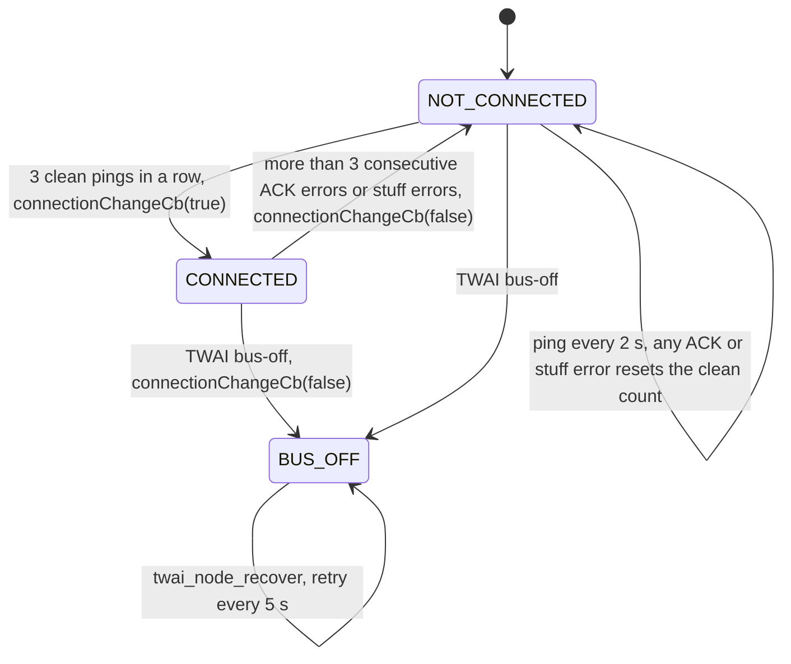
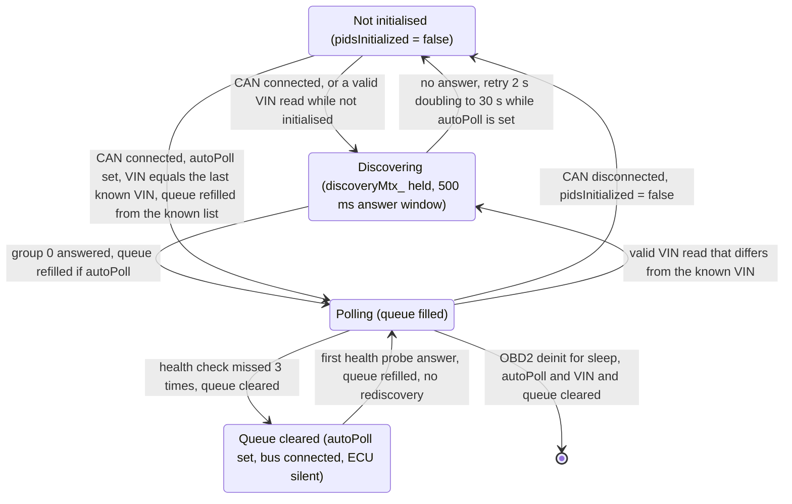
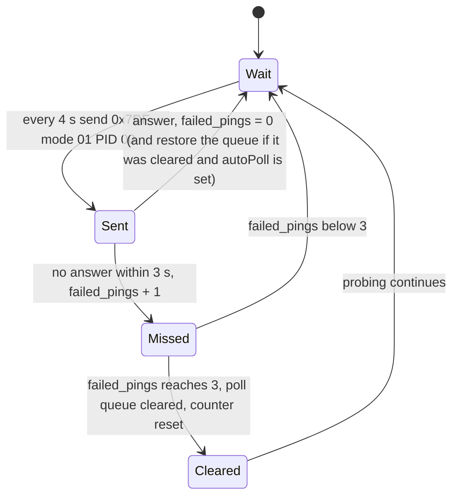
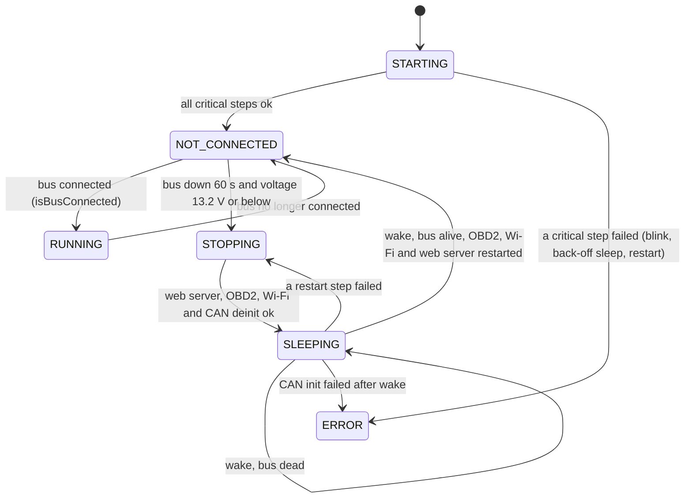

# Architecture

Facts below were read from the code at app version 1.2.4 (`sw/firmware/main/include/utilities.h`). ESP-IDF 6.1 (GCC 15.2, Picolibc, default `-std=gnu++26`), ESP32-S3.

## Components
All paths are relative to `sw/firmware/`. Dependencies are the `REQUIRES` / `PRIV_REQUIRES` in each `CMakeLists.txt`, plus the includes the code really uses.

| Component | Path | Responsibility | Depends on |
|---|---|---|---|
| main (app) | `main/` | `app_main`, then the pieces below that have no component of their own: Supervisor (`src/supervisor.cpp`), Settings (NVS, `src/settings.cpp`), Battery ADC (`src/battery.cpp`), LED (`include/led_status.hpp`), Web server routes and WebSocket (`src/webserver.cpp`), Middleware (`src/middleware.cpp`) | driver, can_driver, obd2, obd2_simulator, wifi, async_web_server, esp_http_server, esp_adc, sd_card; private: json (`espressif/cjson`); managed: `joltwallet/littlefs` |
| Application wiring | `main/src/application_components.cpp`, descriptors in `main/include/production_components.hpp` | Configures and starts/stops components through public APIs; CAN simulator/LED hooks, OBD subscriptions and boot PID loading, SD mount callback, settings loading and private PM-lock setup/storage | Settings, SD card, CAN driver, OBD2, simulator, WiFi, web server, Battery, LED, LittleFS/PM, Supervisor's narrow event/recovery and existing configuration/file methods |
| Supervisor | `main/src/supervisor.cpp` | Executes registered lifecycle callbacks, owns the state machine, sleep/wake and bounded recovery (`power.md`); retains existing PID JSON and file-copy utilities | Application PM acquire/release bridge, Settings (corruption recovery), SD card, CAN driver, OBD2 (PID/file utilities), Battery, LED, middleware (`m_pid_def_put`) |
| CAN driver | `components/can_driver/` | TWAI node, RX and TX queues, TX task, bus health check task, connected/disconnected callback, loopback/debug mode, `isBusConnected()`, `quickCheckBus()`. Operation admission: `transmit`, `transmitUrgent`, `receive`, `availableMessages`, `flushRxQueue`, `getStatus` and `quickCheckBus` go through `OpGate` (`include/op_gate.hpp`); `deinit()` closes it, waits up to 3 s for calls in flight and returns `ESP_ERR_TIMEOUT` (nothing freed) if one is still blocked, `transmit` and `receive` clamp their timeout to 2 s so the drain always outlasts them. The TX-done hook ({fn,arg}) is one `HookCell` (`include/hook_cell.hpp`): the ISR reads a consistent pair without blocking, and `setTxDoneHook` returns true only after any callback running on the old pair has finished (false after 200 ms), so the caller may free the old arg (OBD2 init fails and OBD2 deinit returns `ESP_ERR_TIMEOUT` when it returns false) | esp_driver_twai, driver |
| OBD2 | `components/obd2/` | The `OBD2` class is split by concern: `obd2.cpp` (lifecycle, callbacks), `obd2_poll.cpp`, `obd2_rx.cpp`, `obd2_transport.cpp`, `obd2_discovery.cpp`, `obd2_recovery.cpp`, `obd2_diag.cpp`, with private shared bits in `obd2_internal.hpp`. Contents: PID database (`obd2_data_model.cpp`), formulas (`pid_def.cpp`), hardware-free frame parsing and ISO-TP reassembly (`obd2_frame.cpp`), PID JSON validation and serialization (`pid_json.cpp`), poll scheduler (`include/pid_priority_queue.hpp`), receive task, ISO-TP multi-frame (DTC, VIN), supported-PID discovery, DTC and VIN requests | can_driver, tinyexpr. It does not touch the SD card; the supervisor does the JSON file I/O |
| TinyExpr | `components/tinyexpr/` | Vendored expression parser (compiled with `-w`) | – |
| OBD2 simulator | `components/obd2_simulator/` | Answers requests with synthetic frames when the CAN config has `debug=true`. Two ECUs: 0x7E8 answers everything (PIDs, DTC, VIN), 0x7E9 only DTC and VIN requests (own DTC set overlapping ECU 0, same VIN); flow control sent to 0x7E0 or 0x7E1 releases that ECU's consecutive frames. The RX ISR passes CAN ID and data bytes to a 16-entry static queue (`simDroppedFrames` counts overflows) | can_driver, obd2 |
| SD card | `components/sd_card/` | SDMMC mount, hot-plug via the card-detect pin, task-affine operation lease (recursive mutex; the supervisor's status poll waits at most 250 ms; download 5 min, upload 60 s and delete 30 s deadlines), file ops, path validation | driver, fatfs, freertos, sdmmc; private: json |
| WiFi | `components/wifi/` | AP, STA or AP+STA, STA retry then AP fallback, mDNS; asynchronous bounded-output scanning (`wifi_scan.cpp`, policy/SSID helpers in `include/wifi_scan_policy.hpp`) | esp_wifi, esp_timer, nvs_flash, espressif/mdns |
| Access control | `main/src/auth.cpp` (device glue), `main/include/auth_*.hpp` (rules, IDF-free, host-tested: `auth_core`, `auth_pin`, `auth_sessions`, `auth_backoff`, `auth_claim`, `auth_http`), `main/include/host_guard.hpp` | Host/Origin guard and Content-Type policy, then 6-digit PIN (PBKDF2-HMAC-SHA256 in NVS), Bearer sessions in RAM, global login backoff, BOOT-press claim and BOOT-hold recovery. The route table's `gated` flag drives one check (`requireAdmin`) in `AsyncWebServer::Config::request_filter` (HTTP task) and `route_shim` (worker, for bodies over 1 KiB). Started before and stopped after the web server (`start_access_control` / `stop_access_control` in `webserver.cpp`). Rules and endpoints: `api.md`, Authentication | mbedtls (PBKDF2), nvs_flash, button |
| Button | `components/button/` (`button.c`, `include/button.h`, IDF-free `include/button_logic.h`) | GPIO0 (BOOT) reader: both-edge interrupt wakes one task, 30 ms debounce, `button_last_press_us()`, hold hook after 10 s (PIN recovery, `auth_service`). Read-only: GPIO0 is a strapping pin and is never driven. Started and stopped by `setup_web_server()` / `stop_web_server()`, because only the API uses it. `init()` failure is logged and the device runs on without claim and recovery | esp_driver_gpio, esp_timer |
| Async web server | `components/async_web_server/` | Wraps `esp_http_server`: request queue, worker tasks, rate limit, WebSocket broadcast | esp_http_server, esp_timer |
| Web server (routes) | `main/src/webserver.cpp`, `main/src/middleware.cpp` | REST routes, WebSocket handler. `webserver.cpp` does HTTP parsing and calls `m_*` functions in `middleware.cpp`, which return cJSON | OBD2, SD card, Settings, Supervisor, CAN driver |
| Frontend | `../frontend/` (Svelte, built with bun) | UI, served as one gzipped file from the `www` LittleFS partition | REST and WebSocket only |
| Recorder | `components/recorder/` | Records selected PID updates to `/logs/trips/trip_NNNNNN.csv` plus a JSON sidecar (`sd-card.md`). Pure rules in `include/recorder_core.hpp` (state machine, CSV row format, trip names, PID filter, flush and rotate policy, callback gate; host-tested) and `include/recorder_queue.hpp` (256-row drop-oldest queue). `recorder.cpp`: `Recorder::init/deinit/start/stop/getState/getStatus/listTrips`. `init()` subscribes to OBD2 PID updates; the callback only reads the PID, filters it and does a non-blocking queue push. A writer task is created by `start()` and deleted by `stop()`. Manual start/stop only; automatic trip rules and 0–100 timing are planned (R6, R7). REST and WebSocket: `api.md` | obd2, sd_card, freertos, cjson |
| Recorder wire rules | `main/include/recorder_http.hpp` | Start-body parser and the 16-byte WebSocket state frame (IDF-free, host-tested) | – |
| CAN raw stream | `components/can_raw/` | Monitor-mode tap, read-only. `include/can_raw_core.hpp` (IDF-free, host-tested): frame record, 256-slot ring, 0x10 batch and 0x11 stats encoders, command parser, capture/pump `Core` with drop accounting. `can_raw.cpp`: `CanRaw::init/deinit/start/stop`, spinlock, drain task. Installs `CanDriver::setFrameTap`; sends through a sink callback set by `webserver.cpp`. `init()` and `deinit()` run inside the web server's setup and stop, not as a supervisor component (it needs no hardware and stops before the web server's HTTP side). Wire format: `api.md` | can_driver, freertos |
| OTA (planned) | – | Not in the code (`ota.md`). `partitions.csv` already has `otadata`, `ota_0`, `ota_1` | – |
| Modem (v2, planned) | – | Not in the code | – |

Layering discrepancies, as built:
- `webserver.cpp` calls `SDCard` directly for SD file upload and download, instead of going through `middleware.cpp`. The rule in `CLAUDE.md` says firmware data goes through the middleware.
- `Recorder::init` calls `OBD2::getInstance().subscribe(...)` directly (component to component through the public OBD2 header, not through the middleware), and reads `OBD2::getData`/`getDef`/`getVIN` and uses `SDCard` from its own task. The callback captures a generation number so a callback left over from an earlier `init` does nothing (OBD2 has no unsubscribe; `OBD2::deinit` clears the list).
- `webserver.cpp` calls `OBD2::getInstance().subscribe(pid_stream_callback)` directly (`setup_web_server`) to push PID updates to WebSocket clients, instead of going through `middleware.cpp`.
- `supervisor.cpp` includes `middleware.hpp` (it calls `m_pid_def_put` to load PID JSON), so the supervisor depends on the web layer.
- `main/main.cpp.disabled_sd` is a stray, unused file.

### Frontend packaging (as built)
`main/CMakeLists.txt` defines a custom target that runs `bun run build` in `sw/frontend`, then `littlefs_create_partition_image(www "../../frontend/dist" FLASH_IN_PROJECT)` builds a LittleFS image from `sw/frontend/dist` and flashes it to the `www` partition (1M in `partitions_v1.csv`, 832K in the v2 `partitions.csv`; the gzipped UI is about 310 KB; type `data`, subtype `spiffs`, mounted by label as LittleFS). The web server serves only `/` and it reads `/www/index.html.gz`. Other files in `dist` are not served. Frontend commands (bun install, dev, build, check) are in `.claude/rules/frontend.md`; `vite.config.js` inlines everything into one HTML file and gzips it.

## FreeRTOS tasks
Priorities are absolute FreeRTOS numbers (`tskIDLE_PRIORITY` is 0). "Core" is the pinned core, "any" is `tskNO_AFFINITY`. Stack is in bytes, as passed to `xTaskCreate*`. The tick rate is 1000 Hz (`CONFIG_FREERTOS_HZ=1000`).

| Task | Owner | Core | Stack | Priority | Blocks on |
|---|---|---|---|---|---|
| `main` (`app_main`) | ESP-IDF | 0 | 8192 (`CONFIG_ESP_MAIN_TASK_STACK_SIZE`) | 1 (IDF default) | `vTaskDelay` 250 ms until the supervisor reports RUNNING, then `vTaskDelay(1000)` forever |
| `SupervisorTask` | `main/src/supervisor.cpp` | 1 | 4096 | 1 | `vTaskDelay(1000 ms)` at the end of every loop; in SLEEPING also `vTaskDelay` of the sleep time |
| `led_worker` | `main/include/led_status.hpp` | any | 1536 | 2 | binary semaphore with timeout |
| `WSDataStreamTask` | `main/src/webserver.cpp` | 1 | 4096 | 1 | `vTaskDelayUntil` 1000 ms; when no WebSocket client is connected, `xSemaphoreTake(WSDataStreamSemaphore, portMAX_DELAY)` |
| `button` | `components/button/` | any | 4096 | 2 | `ulTaskNotifyTake` forever while idle (woken by the GPIO0 ISR); while BOOT is held, with a timeout until the 10 s hold. Exists only while the web server is up |
| `httpd` | ESP-IDF HTTP server (`httpd_start`) | any | 8192 (set in `async_web_server.cpp`) | 5 (`HTTPD_DEFAULT_CONFIG`) | `select()` on sockets. Also runs the WebSocket send work queued by `wsBroadcast` |
| `async_req_worker` x6 | `components/async_web_server/` | any | 8192 | 5 | `xQueueReceive(request_queue, portMAX_DELAY)`. Queue depth is 12 (2 x workers). All REST handlers run here |
| `can_tx` | `components/can_driver/` | 1 | 4096 | 4 (`TX_TASK_PRIO`) | `canConnectedSemaphore` while the bus is not CONNECTED; otherwise `txQueue` with a 5000 ms timeout. After each frame it waits until 4 ms (`MIN_TRANSMIT_PERIOD_MS`) have passed |
| `can_health_check` | `components/can_driver/` | 1 | 4096 | 3 (`HEALTH_CHECK_TASK_PRIO`) | task notification: forever when CONNECTED, 2000 ms in NOT_CONNECTED (ping period), 5000 ms in BUS_OFF |
| `OBD2_receive_task` | `components/obd2/` | 1 | 8192 | 2 | startup gate event bit, then `xBusConnectionSemaphore` while the bus is down; otherwise `CanDriver::receive` with a 10 ms timeout |
| `OBD2_PollTask` | `components/obd2/` | 1 | 8192 | 1 | startup gate, then `ulTaskNotifyTake` with the wait time of the poll queue (next due request) |
| `OBD_Connection_callback_task` | `components/obd2/` | 1 | 4096 | 0 | `xQueueReceive(event_queue)` with a 100 ms timeout. Runs the supervisor's VIN and DTC requests and the discovery retries while `autoPoll` is set |
| `DataSimTask` | `components/obd2_simulator/` | 1 | 4096 | 2 | `xQueueReceive(portMAX_DELAY)` on the ISR queue. Exists only when the CAN config has `debug=true` |
| `can_raw` | `components/can_raw/` | any | 4096 | 2 | `ulTaskNotifyTake` forever while the raw stream is off (woken by `start()` and `deinit()`); while on, `vTaskDelay` 20 ms per pass (up to 4 batches, so at most 3200 frames/s) and a stats frame every second. Exists from web server start to stop |
| `recorder` | `components/recorder/` | any | 6144 | 2 | `xQueueReceive` on the row queue with a 200 ms timeout. Exists only between `Recorder::start` and `stop`. Takes the SD lease (250 ms) per batch; deletes itself after `stop()` asks it to finish |
| `sys_reboot` | `main/src/middleware.cpp` | any | 2048 | 5 | one-shot: waits 500 ms, then `esp_restart()` |
| `wifi_scan` | `components/wifi/wifi_scan.cpp` | any | 6144 | 2 | one task per admitted scan; blocks on completion/cancellation semaphore until the 5 s deadline, then at most 500 ms to drain cancellation; exits itself |

Not listed: ESP-IDF system tasks (IDLE, `esp_timer`, event loop, lwIP, Wi-Fi, mDNS).

Wi-Fi scan admission, result publication, reconnect/fallback and driver operations share a recursive lifecycle mutex. Stop/deinit have a separate shutdown mutex: they close admission and wake the scan worker, but never hold the lifecycle mutex while waiting for it or unregistering handlers. A completion handler only publishes status/time and gives a semaphore; it never waits for that mutex. Missing stop completion quarantines scans until reinit rather than allowing a stale completion to satisfy another attempt. Deinit stops the driver and posts a default-event-loop barrier before retiring the internal handler, so queued old events cannot cross an init boundary. A one-shot 100 ms reconnect timer retries deferred event-loop work when the lifecycle lock or event queue was busy; it has no idle wakeups and is stopped with `esp_timer_stop_blocking` and deleted on deinit. Snapshots and JSON have a fixed 20-record bound; the SDK's opaque discovery-list allocations are outside that guarantee (`decisions.md`). Task stack/SDK timing/AP continuity still require board measurements.

Workers and CAN tasks that the supervisor stops are deleted: OBD2 tasks exit on their own, `can_tx`, `can_health_check` and `WSDataStreamTask` exit on their own when asked (flag plus notify or semaphore).

Task watchdog: enabled, 5 s timeout, panic on timeout is off, idle tasks of both cores are checked (`sdkconfig`).

## Startup order
`app_main` (`main/main.cpp`):
1. Sets the `CAN_DRIVER` log level to DEBUG.
2. `LedStatus::init(LED_GPIO)` (GPIO 47 in both pin sets).
3. Registers nine explicit component descriptors (eight legacy roles plus RECORDER, application ID 9) from `production_components.hpp`, then calls error-returning `SUPERVISOR::init({nullptr, application_components::bootstrapSettings})`. Admission validates/freezes the complete registry before any bootstrap side effects. The application-owned bootstrap synchronously initializes NVS and loads only the supervisor's own config on main's caller stack; the core copies its result and one validated power-policy snapshot before creating `SupervisorTask` on core 1. Ordinary component initialization remains asynchronous. A rejected interface/registration/graph is logged and main deep-sleeps on a 3600 s timer (stopping the LED first) instead of idling awake; it retries on wake. Failed bootstrap creates only the bounded ERROR owner; failed task creation runs that same recovery inline, without replacement allocation.
4. Waits in a 250 ms loop until the supervisor state is RUNNING. It never times out.

The legacy boot sequence below contains a synchronous SETTINGS bootstrap prefix followed by eight registered steps run by `SupervisorTask` in STARTING (descriptors in `production_components.hpp`). Each legacy result is kept and shown by `GET /api/v1/system` as `component_status`. An accepted task yields init success even if bootstrap failed: it then owns ERROR recovery and never runs ordinary steps. Init success is not successful component startup.

`supervisor_core.cpp` owns the actual production startup, inactivity, ordered shutdown, wake/probe and recovery orchestration. `supervisor.cpp` supplies hardware/task/sleep operations and short lifecycle critical sections; main owns the registration list and selects application-owned adapters from `application_components.hpp`. Those adapters configure and initialize/deinitialize components through their public APIs. Host tests link the same core and bounded registry with fake operations. No Component inheritance or EventBus is introduced. Neither core nor registry allocates memory. Iteration-based timers and the task's 4096-byte stack/core/priority are preserved; runtime stack headroom still needs measurement.

Application wiring installs the same captureless OBD/SD callbacks on each init, including the VIN/DTC subscriptions, disconnect notification, 1 s OBD delay and PID load/no-card behavior. Main supplies null adapter contexts; callback code, singletons and the application-private PM handle have firmware lifetime. No hardware initialization runs in static constructors. `notify_disconnected()` only forwards the guarded RUNNING-to-NOT_CONNECTED event. `recover_corrupt_settings(section)` keeps the existing RTC-count check/increment, factory reset and restart together; the application cannot access the raw core or counters, and no friend is used. The existing `load_config_from_nvs()` member implementation is colocated with application settings loading without exposing its private configuration.

This separation does not make supervisor policy hardware-agnostic: CAN connectivity/probing, battery reads, transceiver standby, LED/sleep operations, SD status polling and the bootstrap-loaded power snapshot remain deliberate platform/policy integration. Existing PID/file utilities and their layering dependency also remain out of this extraction's scope. Application wiring owns PM configuration/lock creation and rollback; supervisor sleep operations use error-returning acquire/release wrappers without receiving the handle. PM and flash remain ordinary retained registrations, not promoted infrastructure.

`supervisor::SettingsBootstrap` is a plain synchronous callback/context interface, supplied explicitly by main rather than hidden in a component registration. The existing injected `Operations::powerSettings` reader supplies only supervisor policy, once after bootstrap success; Core includes neither Settings nor NVS. Error and policy values are copied; no bootstrap callback/context is retained. Production uses static code, null context and process-lifetime singletons. Bootstrap calls the unchanged `Settings::init()` then the existing System section loader, not all section loaders. CAN/Wi-Fi adapters continue reading their own sections on each init/wake. The registry freezes before this work, including dependency-cycle/lifetime checks; rejection performs no NVS initialization, task creation or normal callback. Missing callbacks/readers return INVALID_ARG without freezing. Repeated/reentrant init and late registration return INVALID_STATE, including during synchronous bootstrap and after failed bootstrap/task creation, so no duplicate NVS work occurs. All callbacks and bounded graph planning run outside interrupt-masked critical sections.

### Component registration
`registerComponent(const supervisor::Descriptor&)` copies metadata into 16 fixed ordinary-component slots, separate from the SETTINGS compatibility prefix: names hold at most 31 bytes plus NUL, with up to four copied dependency edges per component. IDs are stable `uint16_t` values independent of insertion order; ID 0/name SETTINGS/role SETTINGS are reserved infrastructure and cannot be registered, IDs 1..8 are the existing component roles, 9..65534 are application IDs, and 65535 is invalid. Callback code and optional `void*` context must have firmware lifetime; registering a pointer to a main-local object is invalid usage even though the descriptor and name themselves may be temporary. There is no base class, callback allocation, dynamic dependency container or unregister API. Registration/init belong to the boot owner; status and sleep request APIs may run concurrently, including while bootstrap is loading settings.

Admission requires eight unique legacy component role bindings, canonical names/criticality/participation, valid dependencies and an acyclic plan. SETTINGS always precedes the plan structurally; no synthetic SETTINGS initializer is registered. Dependencies on reserved ID SETTINGS refer to the implicit retained bootstrap provider and may require success like other dependencies. Duplicate IDs/names/roles, missing init, missing cycling deinit, overlong names and overflowing capacities return errors without bootstrap, callbacks or task creation. Other dependencies must exist at admission, not necessarily at registration. Rejected admission leaves registration open so missing registrations can be supplied; already accepted descriptors are not replaceable. Once admitted, even bootstrap or task-creation failure cannot reopen registration.

Boot uses dependency-first ordering, then ascending boot priority and stable ID among ready records. Shutdown independently orders consumers before providers, then ascending shutdown priority and ID; it is not reversed boot order. An edge with `requireSuccess=false` imposes ordering/resource lifetime only. With `true`, an inactive provider blocks the init callback with `ESP_ERR_INVALID_STATE`; the consumer is STOPPED (nothing acquired) and boot criticality determines whether startup continues or enters ERROR. A callback that actually fails is PARTIAL and remains eligible for cleanup. The main registrations keep legacy optional-failure behavior and WEB/OBD/WIFI/CAN/SD shutdown order.

Participation is explicit: RETAINED boots once and has no deinit; NORMAL boots, stops before sleep and restarts after a live-bus probe; reserved BATTERY and PROBE bindings retain their separate sensor and CAN phases. Retained consumers cannot depend on cycling providers, and special wake-phase consumers cannot depend on normal components; BATTERY cannot depend on CAN's later probe phase. New normal components such as recorder/modem need only descriptors/callbacks in the application registration list, not changes to supervisor policy switches. Independent `wakeCritical` metadata defaults false: optional extension failures disable that feature while wake continues. A blocked required-success dependent follows its own wakeCritical, not its provider's policy; its callbacks are skipped and phase is STOPPED. Wake-critical failure enters STOPPING. Main marks only OBD wake-critical (Wi-Fi, web and SD are optional; Wi-Fi and web are also non-critical at boot), and admission enforces this metadata. Planning is bounded and runs with registration closed but outside interrupt-masked critical sections.

Sleep preparation uses the production `supervisor_sleep.hpp` transaction with injected timer/release/acquire operations. Timer setup precedes lock release; successful release owns one restore attempt, including battery-cleanup rollback. Preparation failure cannot release a lock on timer failure; failed restoration reports ERROR without further acquire retries or provider startup. The fixed-size transaction and descriptor flag add no allocations or tasks. Core/transaction host tests count nesting across failure paths and repeated cycles. ERROR cleanup retains provider barriers but independently attempts transceiver standby before deep sleep and reports retained live records; GPIO level/direction errors are reported without extending ERROR into a retry loop. GPIO output configuration does not require CAN to have initialized. This establishes software ordering only, not pad retention, hardware sleep entry/current or ADC deletion success; see power.md.

The HTTP view is deliberately separate: exactly nine legacy names, in their original order, with atomic initial-boot results. SETTINGS now reports bootstrap's exact result, stays ESP_FAIL before any attempt, and is never rewritten on wake. Its synchronized C++ lifecycle is NEVER_STARTED before admission, STARTING while loading, then ACTIVE or PARTIAL with the bootstrap error. Failed bootstrap leaves all eight ordinary statuses unattempted. Additional registry records never appear in `component_status`. Their live lifecycle is available through the existing C++ status method by stable ID; there is no new HTTP diagnostic surface or API version change.

Each record also holds a live lifecycle phase and last init/deinit errors. `get_lifecycle_status()` copies one record under the same critical section used to publish it; callbacks and driver calls run outside that section. PARTIAL means init failed or cleanup failed, not that all resources are gone. Already-stopped and never-started records need no cleanup. Existing HTTP `component_status` still reads only atomic initial-boot results, including ESP_FAIL for unattempted steps; wake and cleanup never rewrite those results. No new diagnostic endpoint is added.

The gated manual-sleep route uses `manual_sleep_http.hpp` in production: validate empty request, reserve in the core, send 202, then finish with success/publication or failure/cancellation. Middleware only forwards reserve/finish to the process-owned supervisor. Admission uses the existing short critical section, a single reservation and a monotonically increasing nonzero token (no wrap); no heap, worker wait, delayed task or caller-owned completion is added. Core teardown/ERROR invalidates outstanding reservations. Host tests exercise this dispatch helper with the actual core, including send failure, stale completion, explicit-sleep override and retained provider barriers. SDK delivery, async-worker drain timing and physical sleep remain on-target validation boundaries.

System power settings live in `SUPERVISOR::Config::power`: integer millivolt thresholds (13200/11400 defaults) and `sleep_enabled` (true by default). Successful bootstrap invokes the small policy reader once and publishes a coherent validated copy before task creation; failed bootstrap or an invalid reader result retains safe defaults. A successfully copied policy remains available even if task creation fails, but ERROR backoff still ignores automatic-sleep enable. This power policy and NVS bootstrap are not rerun on wake or each iteration; existing CAN/Wi-Fi wake setup still reads their own settings. `power_settings.hpp`, `power_settings_storage.hpp` and `power_settings_json.hpp` supply the production-used validation, typed NVS recovery/write sequence and JSON merge/serialization tested on the host. Physical NVS persistence/commit and SDK behavior still need on-target verification. The existing frontend settings contract is a generic JSON record, so no frontend type or UI change is required. Settings remain reboot-required; HTTP component status and API version remain unchanged.

| # | Step | What it does | Critical |
|---|---|---|---|
| 1 | SETTINGS (bootstrap prefix, caller) | `Settings::init()` (`nvs_flash_init`, unchanged erase and retry on `NO_FREE_PAGES` or `NEW_VERSION_FOUND`), then loads only supervisor config (PID/DTC paths and power policy) from NVS; not a registered component | yes |
| 2 | POWER_MANAGEMENT | `esp_pm_configure` max 240 MHz, min 40 MHz, automatic light sleep on. Creates and takes an `ESP_PM_NO_LIGHT_SLEEP` lock | yes |
| 3 | FLASH_FILESYSTEM | Mounts the `www` partition read-only as LittleFS at `/www` (no format on failure) | yes |
| 4 | SD_CARD | `SDCard::init` (SDMMC slot 1, 1-bit, card-detect GPIO). Returns OK even when no card is inserted. If a card is present it mounts it, and the mount callback creates `/config` and `/logs`. `format_if_mount_failed` is false (formatting is explicit only) | no |
| 5 | BATTERY | ADC1 channel 1 oneshot | no |
| 6 | CAN | Reads the CAN config from NVS (defaults on first boot; a missing key takes its default and the other stored keys are kept), installs the simulator hooks if `debug`, `CanDriver::init` | no |
| 7 | OBD | Registers the connected-callbacks, `OBD2::init()` (needs the CAN driver initialized), waits 1 s, then loads the PID JSON from the SD card. No card mounted: warns and returns OK with no PIDs. Card mounted but the file is missing or fails to parse: returns an error | no |
| 8 | WIFI | Reads the Wi-Fi config from NVS (defaults on first boot; a missing key takes its default and the other stored keys are kept), `WIFI::init` + `start` | yes |
| 9 | WEBSERVER | `setup_web_server()`: starts `AsyncWebServer`, registers routes, subscribes `pid_stream_callback` to PID updates, creates `WSDataStreamTask`, with access control brought up first: `button_init()` (a failure only disables PIN claim and recovery) and `auth_service::start()` (loads the PIN record; a storage failure only closes the gated routes) | yes |
| 10 | RECORDER | `Recorder::init()`: subscribes to OBD2 PID updates and marks the recorder ready. Depends on SD_CARD (ordering only) and OBD (required: skipped if OBD did not start). It starts no task and writes nothing until `start()`. Not critical, not wake-critical | no |

Failure handling:
- A step that fails and is not critical is logged and skipped. The next step still runs and the state goes on to NOT_CONNECTED. The web server then runs with that feature missing (for example OBD calls return 503).
- A critical step that fails sets state ERROR and stops the sequence. The remaining steps are not run, and `component_status` shows `ESP_FAIL` for them. ERROR blinks for 30 iterations, makes one ordered cleanup attempt (retaining failed providers), then deep-sleeps with backoff (60 s doubling per recovery episode, at most 3600 s). Shutdown exhaustion also uses ERROR instead of an immediate restart. History clears only after successful normal teardown, not startup or ERROR cleanup. Core state is atomic; the OBD disconnect callback only moves RUNNING to NOT_CONNECTED. Nonblocking `stop()` requests the same ordered sleep path, never task deletion; singleton ownership and acknowledgment semantics are in `power.md`.
- Settings validation (`main/include/settings_validation.hpp`, host-tested) is applied by `PATCH /settings`, by the `Settings` setters and when a section is read from NVS. A stored key that is too long for its read buffer, has the wrong type or fails validation is replaced by the default for that key only; an inconsistent section (for example WPA2 without a password) loads as the full default section for that boot. Only `ESP_ERR_NVS_CORRUPT_KEY_PART` calls `Settings::factoryReset()` (wipes all of NVS) and `esp_restart()`. Any other read error logs and runs that boot on in-memory defaults without touching the stored values.
- With no SD card, OBD step 7 initializes OBD2 and returns OK without loading PID definitions. There is no built-in default PID set.
- On a first boot the Wi-Fi default is STA mode with an empty SSID. STA-only mode with no SSID switches to AP mode immediately in `start()` (nothing can connect, so no retries run); with an SSID, `sta_max_retry` (5) failed connects switch it to AP mode (SSID "Can Sniffer", open, channel 6).
- After step 9 the state is NOT_CONNECTED. It becomes RUNNING when the CAN driver reports the bus connected (`power.md`).
- The default CAN config sets `debug = DEBUG_MODE` which is 1 (`utilities.h`). With `debug` on, the TWAI node runs in loopback and self-test mode, the loopback pin is driven high, the looped-back request frames go to the simulator and not to the OBD2 RX queue, and `DataSimTask` pushes synthetic ECU responses (ID 0x7E8) straight into the RX queue. A fresh device therefore runs on simulated data until `debug` is turned off in the CAN settings and the device is rebooted.

## Data flow
```
CAN RX ISR → rxQueue (size from CAN config, default 20) → OBD2_receive_task → parseRecFrame ─┬→ PID data map (+ formula) ─→ pid_stream_callback → WebSocket 0x02 packets
   (debug: ISR → simulator instead of rxQueue)                                              ├→ DTC / VIN data ─→ REST (GET /dtc, /vin)
                                                                                             └→ supported-PID bitmaps (discovery)
OBD2_PollTask (priority heap of PollRequest) → queryMsg → CanDriver::transmit → txQueue (10 frames) → can_tx → TWAI TX
Derived PIDs: PollTask → derivedPidQueue (10) → receive task → parseDerivedData → formula with getPID()
WSDataStreamTask → 1 Hz CAN status packet 0x03 → WebSocket
Raw stream (off until a client sends 0xB0): RX: ISR stamps CanFrame.ts_us → rxQueue → CanDriver::receive (frame tap, before the parsers) ─┐
                                            TX: TWAI TX-done ISR (frame really left the controller, flow control included) → frame tap ──┴→ can_raw ring (256) → can_raw task, every 20 ms → bulk broadcast 0x10 (+ 0x11 stats at 1 Hz) → WebSocket
Browser → REST (AsyncWebServer workers) → webserver.cpp handlers → middleware m_* → OBD2 / SD / Settings / Supervisor
```
Recorder: OBD2 receive thread → `pid update callback` → `Recorder::onPid` (filter, `RowQueue::push`, never blocks) → `recorder` task (format, 8 KB or 10 s batches; runs at idle priority so a stuck SD driver cannot starve IDLE) → `SDCard::write_file(append)`. `POST /recorder/start|stop` and `GET /recorder/trips` run on REST workers; `stop` blocks a worker for up to 5 s. The WebSocket state frame 0x04 is broadcast by `WSDataStreamTask` once per second and after a successful start or stop. A normal broadcast is dropped when three normal ones are already pending (B25 admission), so a frame can be missed during a PID flood; the next second repeats it. Besides the recorder, the SD card is written by the PID JSON save, file upload and the SD file copy. Details of each interface are in `api.md`, `pid-config.md` and `sd-card.md`.

## CAN, OBD2 recovery and health check
- CAN driver: `NOT_CONNECTED` becomes `CONNECTED` after 3 clean pings; more than 3 consecutive ACK or stuff errors drop it back (callback on both edges).
- `autoPoll` is the user's intent (`PATCH /api/v1/obd2`), RAM only, cleared by OBD2 deinit. A health failure or bus drop never changes it. `polling` = `autoPoll` and bus connected and recurring entries in the poll queue.
- OBD2 health check (receive task): a mode 01 PID 00 probe every ~`NO_MESSAGE_SENT_HEALTHCHECK_PING_PERIOD_MS`; 3 missed answers clear the whole poll queue while the bus stays CONNECTED. The probe keeps being sent. On the first answer with `autoPoll` set and discovery done, the queue is refilled from the known supported list, no rediscovery.
- Bus connect with `autoPoll` set: read the VIN (mode 09 PID 02). Same VIN as the last completed discovery: keep the supported list and refill the queue. Different, unknown or VIN timeout: run supported-PID discovery, then refill. If discovery fails (cold ECU), the callback task retries with backoff 2 s doubling to 30 s, without holding `discoveryMtx_` while waiting, until it succeeds, the bus drops or `autoPoll` is cleared. With `autoPoll` clear the connect runs discovery once, as before. Any discovery run forgets the known VIN.
- User VIN read (`POST /api/v1/req/vin` and the supervisor's connect-time `requestVIN`, both `OBD2::requestVIN`; not `GET /vin`): on success with a valid 17-character alphanumeric VIN, if OBD is not initialised it runs the same decision as a connect (same VIN: restore the known supported list; otherwise discovery, done by the callback task so the HTTP call does not wait). If OBD is initialised, the same VIN changes nothing, no VIN on record adopts it, a different VIN rediscovers. The queue is refilled only when `autoPoll` is already set; the read never sets it. It uses `discoveryMtx_` with a non-blocking take and skips if discovery is running. Without `autoPoll` a failed rediscovery is not retried.
- DTC (modes 03/07/0A) and VIN (mode 09/02) requests collect the answers of all ECUs (`obd2frame::DiagCollector` in `obd2_frame.cpp`, driven by the receive task, the only owner). The requester starts a collection (`runDiagRequest`), the CAN TX-done event (ISR hook `CanDriver::setTxDoneHook`, matched to the request by `obd2frame::isDiagRequestFrame`) marks the moment the request really left the controller and starts the first-response wait; a request the TX task could not send fails the requester at once with `ESP_FAIL`, the receive task feeds every 11-bit frame on 0x7E8-0x7EF to the collector. One ISO-TP session per response ID (cap `ISOTP_MAX_SESSIONS` 8, length cap 512, sequence wrap 15 to 0, N_Cr 150 ms restarted per valid CF). A bad frame drops only its own ECU's session. Flow control goes to the physical request ID (response ID minus 8), never 0x7DF, and only for a first frame that matches the running request. The poll task is kept off the bus (`xBusArbitrationMutex`) while any session is open; the receive task only tries to take that mutex without blocking, after the flow control is queued, and retries every loop pass while a session is open, so a poll request may interleave when the poll task holds the bus at that moment. Flow control is queued at the front of the TX queue (`CanDriver::transmitUrgent`) with no fixed delay (the old 10 ms wait was dropped: our flow control says STmin 0 and the ECU paces itself). The time from the first frame being read to the flow control frame leaving the controller is measured in the TX-done hook (from the receive task reading the first frame, after the RX queue wait, to the TX-done interrupt, both at tick resolution, 1 ms) and a frame later than `ISOTP_N_AR_MS` (33 ms) is counted and logged (`Flow control missed N_Ar`); a flow control frame that cannot be queued at all is counted the same way and fails the waiting request. `ISOTP_N_AS_MS` and `ISOTP_N_BS_MS` were removed: they are the ECU's own timers. A bus drop ends a waiting request at once with `ESP_ERR_INVALID_STATE` (the requester checks `isBusConnected()` every 50 ms) and the receive task discards the collection. Done when at least one ECU answered, no session or NRC 0x78 is active and no relevant frame arrived for `OBD2_RESPONSE_QUIET_GAP_MS`; no answer within `OBD2_FIRST_RESPONSE_WAIT_MS` of the request going out is a failure (the requester times out after `OBD2_DIAG_WAIT_MS`, 500 ms, unless the collection is progressing: a session is open or an ECU already answered, then it waits up to `OBD2_DIAG_REASSEMBLY_CAP_MS`, 500 + 74 x N_Cr = 11600 ms, since a 512-byte payload needs at most 73 consecutive frames; `obd2frame::diagWaitExpired` decides, a stalled session is dropped after N_Cr so it cannot hold the wait). NRC 0x78 restarts P2* for that ECU, at most `OBD2_MAX_CONSECUTIVE_PENDING` in a row (about 15 s), and extends the requester wait up to `OBD2_DIAG_PENDING_CAP_MS` (the larger of the two caps applies when both hold). DTC response layout (assumed, user-supplied; secondary-source confirmation pending): SID `0x43`/`0x47`/`0x4A`, count byte NN, then NN 2-byte DTCs; only whole pairs that are present are read, never more than NN, so padding and a wrong NN are harmless. DTC result: union over ECUs, de-duplicated, an ECU with zero DTCs still counts as a responder. VIN: the first valid 17-character reply wins, a different valid VIN from another ECU is ignored with a warning. Mode 01 values are unchanged: no source filter, last answer wins.

### State graphs
Read from `can_driver.cpp`, `obd2_rx.cpp` (health probe), `obd2_discovery.cpp` (supported-PID window), `obd2_recovery.cpp` and `supervisor.cpp`. Timings: CAN ping 2 s (`HEALTHCHECK_PING_PERIOD_MS`), OBD2 health probe every 4 s, answer timeout 3 s (`HEALTHCHECK_RESPONSE_TIMEOUT_MS`), 3 misses clear the queue (`HEALTHCHECK_RETRIES`), supported-PID answer window 500 ms.

CAN driver (`can_health_check` task). A TX success resets both error counters.

While CONNECTED the task sleeps until notified; there are no pings. An ECU that stays silent on a live bus is invisible here, which is what the OBD2 health check covers.

OBD2 layer. `autoPoll` is not a state: it stays true through every transition below except OBD2 deinit.


OBD2 health check (receive task). Runs the whole time OBD2 is up; the probe keeps going after a clear.


Supervisor, as it relates to the bus (full sleep path in `power.md`):

The supervisor only reads the CAN driver state. It never sees an OBD2 health failure, so an ECU that stops answering while the bus stays connected does not affect it.

## Sleep and power
The supervisor puts the device into automatic light sleep when the bus stays down. See `power.md`.

## Host tests
`sw/firmware/test/host/` is an IDF project for the linux target (`tools/ci.sh --host`). It compiles `pid_def.cpp`, `obd2_data_model.cpp`, `obd2_frame.cpp` and `pid_json.cpp` straight from `components/obd2/`, plus `tinyexpr` and cJSON. `components/can_driver/` there is a stub header (CAN frame type only), so parsing, formulas, the PID database and the PID JSON build without hardware. Code that talks to the bus (the OBD2 class, tasks, queues) is not host-tested; keep new parsing logic in the pure files. The host build needs `sw/firmware/managed_components/` (run a firmware build first on a fresh clone).

## CAN raw stream (Monitor mode, slice A)
Read-only view of the bus next to normal polling and recording; nothing is transmitted. Per client: a socket takes part after it sends `0xB0` (`api.md`).
- **Tap:** `CanDriver::setFrameTap` (a `HookCell` pair, like `setTxDoneHook`). RX frames are reported by `CanDriver::receive()` right after the receive task takes them from the queue and before `handleDiagFrame`/`parseRecFrame`; TX frames from the TWAI TX-done interrupt, only when the frame really left the controller (a frame `twai_node_transmit` refused is not shown). The RX timestamp is taken in the RX ISR (`CanFrame::ts_us`); the simulator stamps its injected frames the same way, so simulator responses appear as RX and the looped-back requests (which the simulator path consumes in the ISR) appear through the TX tap.
- **Ring:** `Core` keeps 256 frames of internal RAM under one spinlock shared by the receive task, the TX-done ISR and the drain task. A full ring drops the new frame and counts it (`ring`). The ring is allocated by start and freed by stop. When the stream is off the tap costs one hook-slot read and one flag test.
- **Drain:** the `can_raw` task copies at most 24 frames out under the lock, encodes and sends with no lock held, and discards them only if the transport accepted them and the session did not restart meanwhile (generation check). Each pass sends the 1 Hz stats frame first when it is due, and when the bulk slot is busy then it holds the batches back for that pass (frames stay in the ring) so batches cannot keep retaking the slot; otherwise stats were starved under load (2 in 20 s on hardware). `busy` (no bulk slot free) keeps the frames and retries 20 ms later; `dropped` discards them and counts them as `ws`.
- **Drop counters:** `isr` (driver RX queue full, `CanDriver::getRxDropped` since start), `ring`, `ws`. Their sum since the previous accepted batch is in the batch header (saturating at 65535, the rest carries into the next one); cumulative values are in the 1 Hz stats frame.
- **Subscribers:** `can_raw::Subscriptions` (IDF-free, host-tested) is a bounded set (20) of socket descriptors owned by `webserver.cpp`. `0xB0` adds the sending socket (the first one starts `CanRaw`), `0xB1` and the socket-closed hook remove it, and the ring stops when the set becomes empty or the last WebSocket client closes. Every user of the set runs in the HTTP task (WebSocket handler, `on_socket_closed`, the bulk send), so it needs no lock. `AsyncWebServer::Config::bulk_subscribed` lets the bulk send ask the set whether a socket wants a batch; a stats reply to one requester (failed start) names its descriptor and bypasses the set. Not host-testable: the HTTP-task glue itself (`ws_can_raw_start/stop`, the close paths); the set, the dispatch selection and the start/stop rules are.
- **Lifecycle:** the order of init, tap install, ring allocation and teardown is `can_raw::Lifecycle` (IDF-free, host-tested with a fake environment: repeated cycles, deinit while running, failed tap install ends the task it started, timeouts are retryable). `setup_web_server` calls `CanRaw::init` after the route table is up (failure disables only this feature); `stop_web_server` calls `deinit` first. `deinit` frees the ring, clears the tap (waits for a running tap call, `ESP_ERR_TIMEOUT` means retry) and ends the task. The supervisor's component order and `power.md` do not change. The stream stops when the last WebSocket socket closes (`can_raw::stopOnClose`, used by the close-frame path and `on_socket_closed`) or on `0xB1`.
- **Bus load:** `Core::tap` adds the nominal bit count of every tapped frame (`frameBits`: 47 + 8n standard, 67 + 8n extended, interframe gap included, no stuff bits, no error frames) to a saturating 32-bit counter under the lock it already holds, before the ring can refuse the frame; no float in the ISR path. Each stats frame divides the counter by `bitrate x elapsed ms` (64-bit integer maths, permille, clamped to 1000) and restarts the window. The bit rate is read from the running `CanDriver` config; `0xFFFF` is reported while the driver is down or when no time has passed. A stats frame the transport refuses still consumes its window.
- **Hardware filter:** with the CAN config `filter` on (default off) the controller drops non-matching frames before the tap; stats flag bit 1 reports it. The filter is not changed while streaming.
- **Control rate:** `0xB0` is accepted at most every 500 ms (it allocates the ring), `0xB1` never waits, and the on/off log lines are limited to one per 5 s (`LogGate` in `webserver.cpp`). `CanRaw::sendInactiveStats` (start failed) runs the sink on the HTTP task; the sink only submits a broadcast, so it does not block.
- **Not implemented yet:** raw send, ISO-TP reassembly of raw frames, polling-off and parser-off switches, recorder pause (slices B and C).

## CAN view mode and raw send (slice B)
- **Mode controller:** `main/include/can_mode.hpp` (IDF-free, host-tested) is a table of modes (name, enter, exit, allowed ops) plus a `Controller<Env>`; Monitor and Raw exist. It is outside the supervisor, whose states are power and bus health. `main/src/can_mode_service.cpp` wires it to the supervisor (RUNNING check), the recorder (busy check), OBD2 (auto-poll save and restore) and a static mutex. One mode for the device. The supervisor does not own the mode: `stopObd` calls `reset(false)` and `stopWebserver` `reset(true)` in `application_components.cpp`; the web server resets on the last WebSocket close, and `WSDataStreamTask` calls `tick()` once a second (idle timeout 300 s, supervisor left RUNNING, retry of a failed restore). A reset that cannot take the mutex within 150 ms is remembered (`Controller::deferReset`, lock-free) and applied by the next `set()` or check. The periodic check is a small `can_mode` task (3 KB, priority 1) created while Raw mode or a pending restore exists and gone when the controller needs nothing, so Monitor mode costs no task and nothing depends on a WebSocket: idle timeout 300 s, supervisor left RUNNING (best-effort restore of the saved auto-poll setting, since a bus drop keeps OBD2 running), failed-restore retry, deferred reset. `can_mode_service::run()` executes an action with the mode lock held and the mode checked: `POST /can/send` runs its recorder, polling and rate checks and the send in it, `POST /recorder/start` runs `Recorder::start` in it, `PATCH /obd2 {"auto_poll":true}` runs the setter in it (refused with 409 `RAW_MODE` in Raw mode; the `kOpPollOn` op of the mode table), so neither a recording nor Raw mode can begin between the check and the action (Raw entry also re-checks the recorder after stopping polling and rolls back). A lock that cannot be had in 1 s fails closed (503 `BUSY`).
- **Raw send:** `POST /can/send` (gated) validates in `main/include/raw_tx_policy.hpp` (ids, single-frame PCI, service allow-list), checks mode, recorder, polling and a 250 ms `LogGate`, then calls `OBD2::sendRawFrame`. That takes the diagnostic request slot without waiting (so it never overlaps a DTC or VIN request), builds the frame through `queryMsg`, and waits (at most 250 ms, polling every 2 ms) until the TX-done ISR (`OBD2::onTxDone`) sees the same id, length and bytes. The frame is not queued through the poll queue, but the send takes `xBusArbitrationMutex` (50 ms wait, else `BUSY`) after the diagnostic slot: the poll task and with it the health ping stay off the bus for the send, and a raw frame never lands inside an ISO-TP exchange the receive task holds the mutex for. The receive task also skips the health ping while a raw send waits, and a raw frame that is byte for byte the ping waits 20 ms for a ping queued just before. After a 250 ms `TX_TIMEOUT` the frame may still go out later. The reply says only "sent"; ECU responses are seen in the raw stream.
- **Flow control:** with `isotp_flow_control`, `sendRawFrame` arms `obd2frame::RawFlowControl` (`components/obd2/include/raw_flow_control.hpp`, IDF-free, host-tested): 1.5 s window, one `30 00 00` per ECU per arming, first frames announcing at least 8 bytes only, and only the ECU a physical send addressed (all eight after 0x7DF). The first frame of any kind from an addressed ECU uses up that ECU's share, the responder stands down when all addressed ECUs have spoken, every raw send re-applies it (`apply`: option off disarms), and `POST /can/mode` with `isotp_flow_control:false` disarms it. The receive task calls `serviceRawFlowControl` right after `syncDiagRequest`, sends through the same `sendFlowControlFrame`/`transmitUrgent` path as the collector and stamps `fcFirstFrameMs_`, so N_Ar latency is measured and counted by the existing hook. It does not use `diagRequest_` or the collector and stands down while `diagRequest_` is set.
- **OBD parsing and request routes (2026-10-30):** `Controller` publishes `cur == Monitor || obd_parsing` to `OBD2::setParsingEnabled` (a relaxed atomic, no lock in the rx path) on every change, every revert path included; `OBD2::deinit` sets it back to true. The receive task, after tap and `serviceRawFlowControl` (so the flow-control responder keeps working), skips `handleDiagFrame`/`parseRecFrame` when it is false and stops expecting the health-ping reply. The REST routes in `OBD_REQUEST_ROUTES` (`api_routes.hpp`) hold a `can_mode_service::ObdRequestGuard`: mode check under the lock, a counter that makes Raw entry answer busy while a request runs, nothing held across the request itself. `GET /can/mode` reads `Controller::view()`, a lock-free word the controller refreshes itself on every transition (set, reset, deferred reset, idle timeout, supervisor leaving RUNNING), so it never waits for a long request and cannot go stale. (e0095c2 kept a copy in the service that only some paths refreshed: after the last WebSocket closed the mode did revert but GET kept saying raw.) Non-REST senders are covered by one flag, `OBD2::setRawActive` (published by the controller on every transition, before the polling restore on exit): `req()` refuses, the poll task drops one-shot entries, `handleCanConnected` plans no recovery/discovery (`obd2frame::planConnectWork`), `recoveryTick` and the VIN-discovery arming do nothing, and entering Raw clears the pending recovery/discovery flags and flushes the poll queue. PID discovery skipped while in Raw runs at the next connect or when polling is turned on again (`setAutoPoll(true)` arms recovery).
- **Health ping in Raw mode (2026-10-30):** off. `Controller` publishes `cur == Monitor` to `OBD2::setHealthPingEnabled` next to the parsing flag, on every transition. The receive task decides with `obd2frame::healthPingDue(enabled, now, last, period, rawSendWaiting)` (host-tested); while it is off the schedule is held (`last` follows `now`, missed-ping count cleared), so the first ping after Raw comes a full period later. The CAN driver's own health task pings only in NOT_CONNECTED, and Raw needs the supervisor in RUNNING (bus connected), so it never runs for Raw. What Raw shows for the bus: the driver state stays what it was (CONNECTED). It decays only through ACK/stuff errors on transmitted frames, so a raw send on a dead bus drops it (the supervisor leaves RUNNING and Raw reverts), and otherwise the restarted ping detects the loss within one period after Raw ends. Nothing reports a loss falsely and nothing stale remains after the revert. `OBD2::deinit` sets the flag back to true.
- **Not host-testable:** the REST workers and the HTTP-task close hooks, the mutex and tick wiring, `sendRawFrame` against the real TX-done ISR and bus timing, and the flow-control latency on a bus.

## WebSocket broadcast dispatch

`wsBroadcast` copies each binary payload into one owned work item. Client enumeration, upgraded-state checks and sends all run within that item's HTTPD callback; no client FD is retained across queue turns. Recipients are the currently upgraded clients at execution time, not a snapshot taken by the producer. The binary protocol and global stream flags are unchanged.

Two classes, each with its own pending budget, in one atomic word together with the stop bit. Normal broadcasts (PID updates, status, recorder state, pong) carry at most 125 payload bytes and at most three may be pending (`kMaxPending`, producers still submitting included). Bulk broadcasts (the raw CAN stream: `0x10` batches and `0x11` stats, `wsBroadcastBulk`) carry at most 257 bytes and at most one may be pending (`kMaxBulkPending`). The SDK control mailbox has six slots and its own session closes need room, so the total is four. The budgets do not touch each other: a saturated stream never makes a PID update fail, and a PID flood never takes the stream's slot (a refused batch is kept and retried, a refused stats frame is retried on the next pass). The allocation is the work header plus the actual payload length. A bulk broadcast goes only to the subscribed clients (or to its one target socket) and only if their socket passes a zero-timeout writability check; a subscribed client that cannot take it is skipped and the frames of that batch move from `streamed` to `ws` drops (`takeBulkSkipped`, `Core::markSkipped`), so a slow phone cannot block the HTTP task in a send and no frame is counted twice. Admission, allocation or queue failure drops the broadcast; send and enumeration errors are logged. The drop warning and the per-client send-failure warning are each limited to one line per 5 s with a count of the suppressed ones (`LogGate`). Shutdown closes admission, discards queued broadcasts as their callbacks run, and waits for all accepted work (both classes) to release its payload before stopping HTTPD. A drain timeout leaves HTTPD alive for a later stop retry. No lifecycle lock is held across queueing or sending.

## Web server limits (measured with `tools/load-test.py`, simulator, V1_1 board)
- Without WebSocket clients the server held 8 to 16 parallel HTTP clients: p50 91 to 105 ms, p95 0.4 to 1.2 s, over 50 requests/s answered with `429` (the global rate limit), no `503`. At 32 parallel clients about 35% of requests timed out (5 s) and p95 was 4.6 s.
- With 3 WebSocket clients streaming (about 17 packets/s each, which stayed nominal), the same HTTP load collapsed: p50 up to 5 s and most requests timing out from 4 parallel clients up. The device never reset and recovered once the load stopped.
- Opening several WebSockets at the same instant stalls the whole server for about 10 s: the extra handshakes time out and every HTTP request stalls. Opening them 1 s apart works.
- After heavy load `GET /api/v1/system` once took 8 to 12 s, or timed out, while other endpoints answered in 40 ms; a reboot cleared it.
- Not measured under load: sleep and wake. Stack and heap margins under load: `plan/STATUS.md` Metrics.

## Development login bypass
For frontend work without a token. Create `sw/firmware/sdkconfig.dev` (gitignored) with the single line `CONFIG_SNIFFER_AUTH_DEV_BYPASS=y`, then build into a separate directory so the tracked `sdkconfig` stays clean: `idf.py -C sw/firmware -B sw/firmware/build-dev -D SDKCONFIG=sw/firmware/build-dev/sdkconfig -D "SDKCONFIG_DEFAULTS=sdkconfig.defaults;sdkconfig.dev" build` (add `-p /dev/ttyACM0 flash` to flash it). `tools/ci.sh` never builds it and refuses a committed `=y`. Details: `decisions.md` (P2.10f), `api.md` (`dev_bypass`).
